 

  

  

## `~/stack`

<table>
<tr>
<td align="center"><b><code>languages</code></b></td>
<td>

</td>
</tr>
<tr>
<td align="center"><b><code>data</code></b></td>
<td>

</td>
</tr>
<tr>
<td align="center"><b><code>backend</code></b></td>
<td>

</td>
</tr>
<tr>
<td align="center"><b><code>tools</code></b></td>
<td>

</td>
</tr>
</table>

 

## `~/stats`

  

## `~/activity`

  

  

 

<code>BUILD • LEARN • EXPERIMENT • REPEAT</code>

  

<code>:wq</code>

